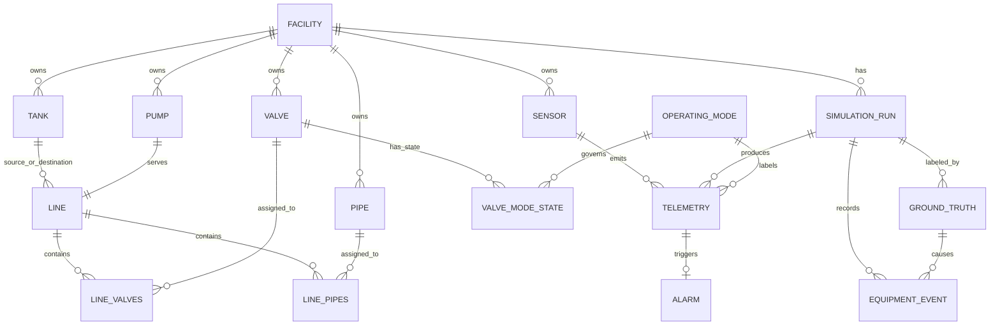

# Data dictionary

This dictionary describes the generated network dataset. CSV values are text; consumers should parse them using the types below. Blank values are optional and become SQL `NULL`. All identifiers are immutable uppercase strings. The first ten sections are the ten core entities; supporting/evaluation tables follow. All data is synthetic.

## Core entities (10)

### 1. Facility — `facilities.csv`

| Field | Type | Required | Allowed values / units | Unique / validation |
|---|---|---|---|---|
| `facility_id` | string | yes | `FAC-NNN` | Primary key; referenced by all facility equipment. |
| `name` | string | yes | Non-empty | Human-readable facility label. |
| `lifecycle_state` | enum | yes | `planned`, `active`, `maintenance`, `out_of_service`, `retired` | Lifecycle transitions are listed below. Generated rows currently use `active`. |

### 2. Pump — `pumps.csv`

| Field | Type | Required | Allowed values / units | Unique / validation |
|---|---|---|---|---|
| `pump_id` | string | yes | `PUMP-NNN` | Primary key. |
| `facility_id` | string | yes | Facility ID | FK to Facility. |
| `line_id` | string | yes | Line ID | FK to Line; one pump per line. |
| `nominal_flow_m3_h` | decimal | yes | m³/h, positive | Nominal flow must be > 0. |
| `shutoff_head_m` | decimal | yes | m, positive | Pump head at zero flow; must be > 0. |
| `lifecycle_state` | enum | yes | `planned`, `active`, `maintenance`, `out_of_service`, `retired` | Lifecycle transitions are listed below. Generated rows currently use `active`. |

### 3. Tank — `tanks.csv`

| Field | Type | Required | Allowed values / units | Unique / validation |
|---|---|---|---|---|
| `tank_id` | string | yes | `TANK-NNN` | Primary key. |
| `facility_id` | string | yes | Facility ID | FK to Facility. |
| `tank_role` | enum | yes | `shared_source`, `shared_destination`, `buffer` | Two shared hydraulic tanks and reserve tanks per facility. |
| `capacity_m3` | decimal | yes | m³, positive | Must be > 0. |
| `area_m2` | decimal | yes | m², positive | Must be > 0; used to compute level. |
| `initial_volume_m3` | decimal | yes | m³, between 0 and capacity | Must be within the tank capacity. |
| `lifecycle_state` | enum | yes | `planned`, `active`, `maintenance`, `out_of_service`, `retired` | Lifecycle transitions are listed below. Generated rows currently use `active`. |

### 4. Valve — `valves.csv`

| Field | Type | Required | Allowed values / units | Unique / validation |
|---|---|---|---|---|
| `valve_id` | string | yes | `VALVE-NNN` | Primary key. |
| `facility_id` | string | yes | Facility ID | FK to Facility. |
| `line_id` | string | yes | Line ID | FK to Line. |
| `normal_opening_pct` | decimal | yes | percent, 0–100 | Must be within the physical range. |
| `sequence_order` | integer | yes | Positive integer | Unique within its line; determines series order. |
| `resistance_k` | decimal | yes | m/(m³/h)² in the simplified model | Must be nonnegative. |
| `lifecycle_state` | enum | yes | `planned`, `active`, `maintenance`, `out_of_service`, `retired` | Lifecycle transitions are listed below. Generated rows currently use `active`. |

### 5. Pipe — `pipes.csv`

| Field | Type | Required | Allowed values / units | Unique / validation |
|---|---|---|---|---|
| `pipe_id` | string | yes | `PIPE-NNN` | Primary key. |
| `facility_id` | string | yes | Facility ID | FK to Facility; endpoint nodes must belong to this facility. |
| `line_id` | string | no | Line ID or blank for a reserve-tank manifold | Optional FK to Line. |
| `from_node_id` | string | yes | Tank, pump, or valve ID | Must resolve to an equipment node in the same facility. |
| `to_node_id` | string | yes | Tank, pump, or valve ID | Must resolve to a different equipment node in the same facility. |
| `resistance_k` | decimal | yes | m/(m³/h)² | Must be nonnegative. |
| `edge_role` | enum | yes | `line_segment`, `buffer_manifold` | Describes topology edge purpose. |
| `sequence_order` | integer | no | Positive integer or blank | Present for line segments; optional for manifold edges. |
| `lifecycle_state` | enum | yes | `planned`, `active`, `maintenance`, `out_of_service`, `retired` | Lifecycle transitions are listed below. Generated rows currently use `active`. |

### 6. Alarm — `alarms.csv`

| Field | Type | Required | Allowed values / units | Unique / validation |
|---|---|---|---|---|
| `alarm_id` | string | yes | `ALM-NNNNNNN` | Primary key. |
| `timestamp_utc` | timestamp | yes | ISO-8601 UTC ending in `Z` | Trigger time within its run. |
| `sim_run_id` | string | yes | SimulationRun ID | FK to SimulationRun. |
| `facility_id` | string | yes | Facility ID | FK to Facility and consistent with run/line. |
| `line_id` | string | no | Line ID or blank | Optional FK to Line. |
| `alarm_type` | enum | yes | `abnormal_window_signal` | Alarm came from the labeled-window signal rule. |
| `primary_signal` | enum | yes | `paired_flow_difference`, `pipe_pressure_drop`, `pump_discharge_pressure`, `valve_pressure_drop` | Signal tested by the rule. |
| `trigger_telemetry_id` | string | yes | Telemetry ID | FK to the evidence telemetry record. |
| `window_effect_abs` | decimal | yes | Signal's unit | Finite absolute measured window effect. |
| `noise_sigma_window` | decimal | yes | Signal's unit | Positive/zero noise standard error for the run window. |
| `detector_rule` | string | yes | Documented 3σ window-mean rule | Must match the run's configured detection sigma. |
| `status` | enum | yes | `open` | Alarm lifecycle status. |

### 7. Sensor — `sensors.csv`

| Field | Type | Required | Allowed values / units | Unique / validation |
|---|---|---|---|---|
| `sensor_id` | string | yes | `SNS-001` format (three-digit minimum; expands naturally above 999) | Primary key. |
| `facility_id` | string | yes | Facility ID | FK to Facility. |
| `line_id` | string | no | Line ID or blank for tank-level sensor | Optional FK to Line. |
| `entity_type` | enum | yes | `pump`, `pipe`, `valve_train`, `tank` | Measurement target kind. |
| `entity_id` | string | no | Equipment ID or blank for pipe-mounted sensor | Polymorphic reference; use `pipe_id` for pipe sensors. |
| `node_id` | string | no | Equipment node ID or blank | Location reference when mounted on a node. |
| `pipe_id` | string | no | Pipe ID or blank | Optional FK to Pipe. |
| `position` | enum | yes | `inlet`, `outlet`, `discharge`, `valve_train_outlet`, `pipe_outlet`, `level` | Defines sensor location/sign convention. |
| `metric` | enum | yes | `flow`, `pressure`, `level` | Determines units and noise model. |
| `unit` | enum | yes | Flow=`m3/h`; pressure=`kPa`; level=`m` | Must agree with `metric`. |
| `initial_level_m` | decimal | no | m, tank sensors only | Configured starting level for the static reserve tanks. |

### 8. Telemetry — `telemetry.csv`

| Field | Type | Required | Allowed values / units | Unique / validation |
|---|---|---|---|---|
| `telemetry_id` | string | yes | `TLM-...` | Primary key. |
| `timestamp_utc` | timestamp | yes | ISO-8601 UTC ending in `Z` | Must parse; sample time within run window. |
| `sim_run_id` | string | yes | SimulationRun ID | FK to SimulationRun. |
| `operating_mode_id` | string | yes | Mode ID | FK to OperatingMode. |
| `facility_id` | string | yes | Facility ID | FK to Facility and consistent with sensor/run. |
| `line_id` | string | no | Line ID or blank for tank-level telemetry | Optional FK to Line. |
| `sensor_id` | string | yes | Sensor ID | FK to Sensor. |
| `entity_id` | string | no | Equipment ID or blank | Location metadata; no fault label. |
| `node_id` | string | no | Node ID or blank | Location metadata. |
| `pipe_id` | string | no | Pipe ID or blank | Optional FK to Pipe. |
| `position` | enum | yes | Same location values as Sensor | Must match sensor location. |
| `metric` | enum | yes | `flow`, `pressure`, `level` | Must match sensor metric. |
| `value` | decimal | yes | Unit from sensor | Finite measured value only. |
| `unit` | enum | yes | `m3/h`, `kPa`, `m` | Must match sensor unit. |
| `quality_flag` | enum | yes | `good` | Non-diagnostic quality field in this version. |

### 9. SimulationRun — `simulation_runs.csv`

| Field | Type | Required | Allowed values / units | Unique / validation |
|---|---|---|---|---|
| `sim_run_id` | string | yes | `SIM-2026-NNNNNN` | Primary key. |
| `facility_id` | string | yes | Facility ID | FK to Facility. |
| `seed` | integer | yes | Integer | Reproduces the random stream. |
| `config_hash` | string | yes | SHA-256 hex | Hash of canonical `config_json`. |
| `config_json` | JSON object | yes | Noise assumptions, seed, sample count, model inputs | Must parse; fault schedule/labels forbidden. |
| `started_at_utc` | timestamp | yes | ISO-8601 UTC | Fixed synthetic start instant. |
| `status` | enum | yes | `complete` | Run completed successfully. |

### 10. OperatingMode — `operating_modes.csv`

| Field | Type | Required | Allowed values / units | Unique / validation |
|---|---|---|---|---|
| `operating_mode_id` | string | yes | `MODE-NNN` | Primary key. |
| `name` | string | yes | `nominal` | Unique mode name recommended. |
| `description` | string | yes | Non-empty | Human-readable mode meaning. |
| `effective_from_utc` | timestamp | yes | ISO-8601 UTC | Beginning of validity interval. |
| `effective_to_utc` | timestamp | no | ISO-8601 UTC or blank | Optional open end; when present must follow start. |

## Relationships and ER diagram

`line_valves.csv` and `line_pipes.csv` are the complete many-to-many route bridges. `lines.csv` also repeats one terminal `valve_id` and outlet `pipe_id` for convenient lookups; these are intentionally redundant references and must equal the final sequence entries in the bridges. The valve/mode bridge is `valve_mode_states.csv`; its key includes valve, mode, and effective start. Both mode and bridge rows use effective-from/to timestamps, where end is optional. Tank sensors have no `line_id`; pipe-mounted sensors have a `pipe_id` and may have no `entity_id`. Tank and line links on telemetry are therefore optional depending on sensor location. `Alarm` has one required triggering telemetry row and an optional line association in the general schema. Pipe endpoints are polymorphic node references: because `from_node_id` and `to_node_id` may identify a tank, pump, or valve, they cannot use one ordinary FK. The generator and SQLite validator resolve each endpoint against the union of those three equipment tables and require both nodes to belong to the pipe's facility and differ from each other.

## Supporting and evaluation tables

| File | Key fields and validation |
|---|---|
| `lines.csv` | `line_id` primary key; source/destination tank, pump, terminal valve, and outlet pipe references; source and destination must differ and belong to the same facility. Terminal valve/outlet pipe duplicate the last bridge rows by design. |
| `line_valves.csv`, `line_pipes.csv` | Composite keys (`line_id`, asset ID); both columns are required FKs; sequence order is positive and unique per line. |
| `valve_mode_states.csv` | Composite temporal key (`valve_id`, `operating_mode_id`, `effective_from_utc`); state is `open` in the nominal mode; effective end is optional. |
| `ground_truth.csv` | `scenario_id` primary key; references run, evidence sensor, and evidence telemetry. Contains fault type/parameters, process-fault flag, effect, window noise, `detectable`, and `alarm_detected`; keep separate from features. Sensor faults set `is_process_fault=false`. |
| `process_truth.csv` | `telemetry_id` primary/FK; includes true value, injected noise, and sigma. Evaluation-only; never include in model features. |
| `equipment_events.csv` | `event_id` primary key; references run and cause scenario. Captures equipment operating-state change and restoration; field-level specification follows below. |
| `network_balance.csv` | Composite key (timestamp, run, facility); true/measured residuals, flows, storage rate and tank levels. |
| `fault_location_rules.csv` | Expected signal direction per fault/location; documentation rows, not telemetry. |
| `negative_fixtures.csv` | `case_id` primary key; five isolated invalid examples and validator outcome. |
| `boundary_fixtures.csv` | `boundary_id` primary key; three valid near-limit examples and range-check outcome. |

The `lines.csv` fields are: `line_id` (required primary key), `facility_id` (required Facility FK), `source_tank_id` and `destination_tank_id` (required Tank FKs in that facility and distinct), `pump_id` (required Pump FK, one per line), and `valve_id`/`pipe_id` (required terminal Valve/Pipe FKs mirrored from the final `line_valves`/`line_pipes` sequence entries). The SQL/SQLite validator checks this terminal-reference redundancy.

### Lifecycle states and transitions

The `lifecycle_state` enum on facilities, tanks, pumps, valves, and pipes allows `planned`, `active`, `maintenance`, `out_of_service`, and `retired`. The generated sample currently sets every asset to `active`; lifecycle changes are supported schema states, not transitions emitted in this simulation.

| From | Allowed next state | Meaning |
|---|---|---|
| `planned` | `active`, `retired` | Commission equipment or cancel planned equipment. |
| `active` | `maintenance`, `out_of_service`, `retired` | Remove from normal service or retire. |
| `maintenance` | `active`, `out_of_service`, `retired` | Return to service, remain unavailable, or retire. |
| `out_of_service` | `active`, `maintenance`, `retired` | Restore, repair, or retire. |
| `retired` | none | Terminal lifecycle state. |

These lifecycle transitions are separate from the operating-condition events below.

### EquipmentEvent — `equipment_events.csv`

| Field | Type | Required | Allowed values / units | Unique / validation |
|---|---|---|---|---|
| `event_id` | string | yes | `EVT-NNNNNNN` | Primary key. |
| `event_ts` | timestamp | yes | ISO-8601 UTC ending in `Z` | Must fall within the associated run. |
| `entity_type` | enum | yes | `pump`, `valve`, `pipe`, `sensor` | Determines the entity ID namespace. |
| `entity_id` | string | yes | Corresponding equipment/sensor ID | Polymorphic reference; must resolve within the event's facility/run. |
| `event_type` | enum | yes | `state_change` | Current generator emits state changes. |
| `from_state` | enum/string | yes | State table below | Must be a legal transition for `entity_type`. |
| `to_state` | enum/string | yes | State table below | Must differ from `from_state`. |
| `sim_run_id` | string | yes | SimulationRun ID | FK to SimulationRun. |
| `cause_scenario_id` | string | yes | GroundTruth scenario ID | FK to GroundTruth. |

| Entity | Fault-window transition | Restoration transition |
|---|---|---|
| Pump | `running` → `degraded` | `degraded` → `running` |
| Valve | `open` → `partial` | `partial` → `open` |
| Pipe | `normal` → `leaking`, `blocked`, or `leaking_blocked` | Fault state → `normal` |
| Sensor | `good` → `stuck_at` | `stuck_at` → `good` |

## SQL, JSON, validation, and limits

`data/seed.sql` contains table DDL, primary/foreign keys, and inserts for every generated table, including evaluation tables. `data/export.json` is the feature-oriented JSON and contains no `ground_truth`, `process_truth`, `network_balance`, `alarms`, or `equipment_events` tables. `data/ground_truth.json` separately contains those evaluation/validation tables plus the network validation summary. Both JSON files use compact row arrays with an adjacent ordered `columns` list. `src/validate_sqlite.py` loads the full SQL seed into SQLite and checks FK integrity and joins among telemetry/sensors/runs/modes, telemetry/process truth, ground truth/evidence, alarms/trigger telemetry, and valve/mode rows. The full SQL seed is a validation bundle; detector feature tables must never join to ground-truth/process-truth tables.

`source_manifest.json` records synthetic provenance, seed, relative generator command, SHA-256 hashes for CSV/SQL/JSON/summary outputs, and CSV row counts. `network_validation_summary.json` records row totals, connectivity, validation outcomes, and residual statistics.

The process solver is steady state at each one-minute sample. Shared source/destination tanks evolve; the eight buffer tanks per facility are reserve tanks with configured levels and no simulated flow. Runs last about 69–71 minutes to retain full sensor coverage at exactly 100,000 telemetry rows; this dataset has no diurnal demand profile. Noise settings (2% flow, 1% pressure, 0.5% level relative sigma) are synthetic assumptions, not measured instrument noise. The residual tolerance is a two-sided 99% Gaussian envelope propagated from independent inlet/outlet flow noise, not a measured residual standard deviation or a 3σ residual limit.
